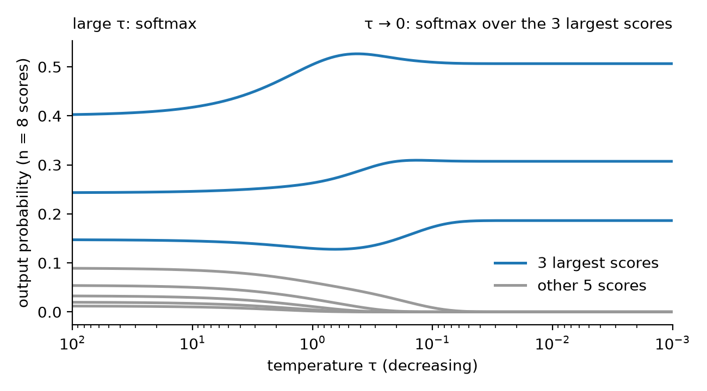

# topkmax

A softmax turns a vector of n scores into a probability distribution in which every entry gets
some probability. Sparse attention and expert routing instead want only the k highest-scoring
entries to receive probability. Selecting those k entries outright is discontinuous in the scores,
and the entries that are not selected receive no gradient, so training gets no signal about
which of them should have been selected.

This repository is an early implementation of a PyTorch operator that interpolates between the two. It
has a temperature τ: at large τ it equals the ordinary softmax, and as τ → 0 it becomes a softmax
over only the k largest scores. It is differentiable at every τ > 0, so τ can start large and be
lowered during training. The package is named `softk`.



The figure shows the output for one input of 8 evenly spaced scores, from 2.0 down to −1.5, with
k = 3. Each curve is the probability of one entry. As τ decreases, the 5 entries outside the top 3
lose their probability, and the top 3 end at the values a softmax over those 3 alone would give.

## Definition

Each score z_i gets a weight m_i between 0 and 1, called the mask, and the output p is the softmax
reweighted by that mask:

```math
m_i = \sigma\!\left(\frac{z_i - t}{\tau}\right), \qquad \sum_i m_i = k, \qquad
p_i = \frac{m_i \, e^{z_i}}{\sum_j m_j \, e^{z_j}}
```

Here σ is the logistic sigmoid, and the threshold t is the single number per row that makes the
mask sum to k. A small τ makes the sigmoid a step, so the mask is 1 on the k largest scores and 0
elsewhere. A large τ makes every m_i equal to k/n, a constant that cancels in the ratio. k does
not have to be an integer.

The scores z_i are the values a model would otherwise pass to a softmax, usually called logits.
The operator does not normalize them. Because τ is measured in
the units of the scores, a given value of τ has a fixed meaning only if each row is standardized
first: zero mean and unit variance across the n scores that share a softmax, for example by a
layer normalization without a learned scale. Without that step a model can sharpen its own output
by scaling its logits up, which bypasses any schedule for τ. The operator also floors τ at 1e-4
times the standard deviation of the row, below which floating-point arithmetic cannot resolve
the mask.

Two details make this cheap to compute:

- The sum of the mask decreases monotonically in t, so t is found by bisection, followed by two
  Newton steps. Of the root-finders compared in `benchmarks/solvers.py`, none needed fewer
  iterations in the worst case.
- The backward pass does not differentiate through the bisection. It uses the implicit function
  theorem on the constraint Σm = k, which gives a closed-form gradient costing two sums per row.

A mask of this form, a sigmoid with a threshold chosen so the entries sum to k, appears in
[The Limited Multi-Label Projection Layer](https://arxiv.org/abs/1906.08707) (Amos, Koltun and
Kolter, 2019).

## Example

```python
import torch
from softk import soft_topk_softmax

z = torch.randn(4, 10)
p = soft_topk_softmax(z, k=3, tau=0.1)                # each row sums to 1; mass concentrates on the top 3
p = soft_topk_softmax(z, k=3, tau=0.1, mode="hard")   # exactly 3 nonzero entries per row
```

In a model, the module `SoftTopKSoftmax` holds τ in a buffer, and `TauScheduler` lowers it during
training:

```python
from softk import SoftTopKSoftmax, TauScheduler

layer = SoftTopKSoftmax(k=3, track_stats=True)          # use in place of torch.nn.Softmax
sched = TauScheduler(layer, tau_start=10.0, tau_end=0.3, total_steps=10_000)

for batch in loader:
    ...                        # forward pass through a model containing `layer`, backward, optimizer step
    sched.step()               # holds tau_start for the first 5% of steps, then decays it to tau_end
    layer.stats                # for logging, e.g. the mean probability outside the top 3

layer.mode = "hard"            # exact zeros for inference
```

## Status

The operator, the training tools and GPU kernels are implemented and tested. The package is not
yet released.

- `soft_topk_softmax` and `soft_topk_mask` work along any dimension, in 16-, 32- and 64-bit
  floating point, and compile with `torch.compile` without graph breaks.
- Three modes are available: the soft formula above, an exact top-k mode for inference, and a
  straight-through mode that outputs the exact top-k result and uses the soft gradient.
- `TauScheduler` supports three decay curves, an optional early stop once almost no probability
  remains outside the top k, an optional final phase in straight-through mode, and saving and
  resuming.
- `softk.stats` has three quantities to log during training: the probability outside the top k, the
  effective support exp(entropy), and how much the selected set changed between two checkpoints.
- On a CUDA GPU, `backend="triton"` runs fused kernels written in Triton, a Python-embedded
  language for GPU kernels. The default `backend="auto"` selects them when they are available.
- The suite of 691 tests passes on one machine with a CUDA GPU. It covers finite-difference
  gradient checks, agreement with an independent double-precision reference, the softmax limit at
  large τ, the top-k limit at small τ, inputs with exact ties at the k-th position, the scheduler's
  curves and resume behavior, agreement between CPU and GPU, and agreement between the kernels and
  the PyTorch code.

### Speed

Times are for one forward pass over 4096 rows of 16384 scores in 32-bit floats on an NVIDIA RTX
5060 Ti, as the median of 20 calls. Raw timings for other sizes, the backward pass and CPU are in
`benchmarks/results/m3.json`.

| Implementation | τ = 1 | τ = 0.01 |
| --- | --- | --- |
| `torch.softmax`, for scale | 1.4 ms | 1.4 ms |
| PyTorch code, uncompiled | 130.6 ms | 130.7 ms |
| PyTorch code under `torch.compile` | 4.3 ms | 4.3 ms |
| Triton kernels | 2.2 ms | 2.9 ms |

The kernels stop iterating on each row once it has converged, so their time depends on the data
and on τ: smaller τ needs more iterations. For rows of 64 scores the compiled PyTorch code is
faster than the kernels, and `backend="auto"` uses it there under `torch.compile`. These timings
come from one GPU model and Gaussian random scores.

One test trains a small network on a synthetic task whose targets are supported on the 4 largest
of 64 teacher scores. On each of 10 random seeds, lowering τ from 10 to 0.3 during training ended
closer to the target than using exact top-k from the first step. That comparison covers one
synthetic task and does not separate lowering τ from simply training with a soft output.

There is no evidence yet that the operator improves a real model.

## Running it

The environment is managed with the Python package manager `uv`.

```sh
uv sync                  # installs softk in editable mode with its test dependencies
uv run pytest -m "not slow"                                     # about 10 seconds on CPU
uv run pytest                                                   # about 80 seconds; adds compilation, training and timing tests
uv run python benchmarks/bench.py --report benchmarks/results/m3.json   # prints the saved timings
uv run python -m softk.demo --k 1 2 4 --input tie --out figs    # plots the output as a function of τ
```
