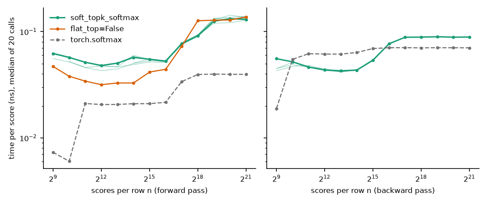

# topk-softmax

A softmax turns a vector of n scores into a probability distribution in which every entry gets
some probability. Sparse attention and expert routing instead want only the k highest-scoring
entries to receive probability. Selecting those k entries outright is discontinuous in the scores,
and the entries that are not selected receive no gradient, so training gets no signal about
which of them should have been selected.

This repository is an early implementation of a PyTorch operator that interpolates between the two. It
has a temperature τ: at large τ it equals the ordinary softmax, and as τ → 0 it becomes a softmax
over only the k largest scores. It is differentiable at every τ > 0, so τ can start large and be
lowered during training. The package installs as `topk-softmax` and is imported as `topk_softmax`.


The figure shows the transition from an ordinary softmax on the left (large τ) to a softmax over
only the 3 largest scores on the right (τ → 0). The input is 8 evenly spaced scores, from 2.0 down
to −1.5, with k = 3, and each curve is the probability of one entry. As τ decreases, the 5 entries
outside the top 3 lose their probability, and each of the top 3 rises monotonically to the value a
softmax over those 3 alone would give.

## Definition

Each score z_i gets a weight m_i between 0 and 1, called the mask, and the output p is the softmax
reweighted by that mask:

```math
m_i = \sigma\!\left(\frac{\min(z_i, c) - t}{\tau}\right), \qquad \sum_i m_i = k, \qquad
p_i = \frac{m_i \, e^{z_i}}{\sum_j m_j \, e^{z_j}}
```

Here σ is the logistic sigmoid, c is the k-th largest score of the row, and the threshold t is the
single number per row that makes the mask sum to k. A small τ makes the sigmoid a step, so the mask
is 1 on the k largest scores and 0 elsewhere. A large τ makes every m_i equal to k/n, a constant
that cancels in the ratio. k does not have to be an integer; c is then the ⌊k⌋-th largest score.

The scores z_i are the values a model would otherwise pass to a softmax, usually called logits.
The operator does not normalize them. Because τ is measured in
the units of the scores, a given value of τ has a fixed meaning only if each row is standardized
first: zero mean and unit variance across the n scores that share a softmax, for example by a
layer normalization without a learned scale. Without that step a model can sharpen its own output
by scaling its logits up, which bypasses any schedule for τ. The operator also floors τ at 1e-4
times the standard deviation of the clamped scores min(z_i, c), below which floating-point
arithmetic cannot resolve the mask.

### Why the scores are clamped at c

The clamp gives the k largest entries one shared mask value, so their probabilities keep the
softmax ratios e^(z_i − z_j) at every τ and rise monotonically as τ decreases. Entries outside the
top k can still rise before they fall.

`flat_top=False` drops the clamp and uses m_i = σ((z_i − t)/τ). It skips finding c, which makes the
forward pass 1.3 to 1.7 times faster for rows of up to 32,768 scores. Its outputs are not
monotonic in τ: at intermediate τ the mask is larger for larger scores, so the largest probability
overshoots its final value and the k-th largest dips before rising. On the synthetic task below it
also trained slightly worse.

### Computing it

Two details make this cheap to compute:

- The sum of the mask decreases monotonically in t, so t is found by bisection, followed by two
  Newton steps. Of the root-finders compared in `benchmarks/solvers.py`, none needed fewer
  iterations in the worst case.
- The backward pass does not differentiate through the bisection. It uses the implicit function
  theorem on the constraint Σm = k, which gives a closed-form gradient costing two sums per row.

A mask of this form, a sigmoid with a threshold chosen so the entries sum to k, appears in
[The Limited Multi-Label Projection Layer](https://arxiv.org/abs/1906.08707) (Amos, Koltun and
Kolter, 2019). Here it is applied to the clamped scores.

## Example

```python
import torch
from topk_softmax import soft_topk_softmax

z = torch.randn(4, 10)
p = soft_topk_softmax(z, k=3, tau=0.1)                # each row sums to 1; mass concentrates on the top 3
p = soft_topk_softmax(z, k=3, tau=0.1, mode="hard")   # exactly 3 nonzero entries per row
```

In a model, the module `SoftTopKSoftmax` holds τ in a buffer, and `TauScheduler` lowers it during
training:

```python
from topk_softmax import SoftTopKSoftmax, TauScheduler

layer = SoftTopKSoftmax(k=3, track_stats=True)          # use in place of torch.nn.Softmax
sched = TauScheduler(layer, tau_start=10.0, tau_end=0.3, total_steps=10_000)

for batch in loader:
    ...                        # forward pass through a model containing `layer`, backward, optimizer step
    sched.step()               # holds tau_start for the first 5% of steps, then decays it to tau_end
    layer.stats                # for logging, e.g. the mean probability outside the top 3

layer.mode = "hard"            # exact zeros for inference
```

## Status

The operator, the training tools and GPU kernels are implemented and tested. The package is not
yet released.

- `soft_topk_softmax` and `soft_topk_mask` work along any dimension, in 16-, 32- and 64-bit
  floating point, and compile with `torch.compile` without graph breaks.
- Three modes are available: the soft formula above, an exact top-k mode for inference, and a
  straight-through mode that outputs the exact top-k result and uses the soft gradient.
- `TauScheduler` supports three decay curves, an optional early stop once almost no probability
  remains outside the top k, an optional final phase in straight-through mode, and saving and
  resuming.
- `topk_softmax.stats` has three quantities to log during training: the probability outside the top k, the
  effective support exp(entropy), and how much the selected set changed between two checkpoints.
- On a CUDA GPU, `backend="triton"` runs kernels written in Triton, a Python-embedded language
  for GPU kernels. Each kernel does a whole forward or backward pass. The default
  `backend="auto"` selects them when they are available.
- `flat_top=False` selects the faster variant without the clamp, as described above.
- The suite of 868 tests passes on one machine with a CUDA GPU. It covers finite-difference
  gradient checks, agreement with an independent double-precision reference, the softmax limit at
  large τ, the top-k limit at small τ, inputs with exact ties at the k-th position, the scheduler's
  curves and resume behavior, agreement between CPU and GPU, and agreement between the kernels and
  the PyTorch code.

### Speed

For rows of 2048 scores or more, the forward pass takes 2.1 to 3.6 times as long as
`torch.softmax` and the backward pass 0.7 to 1.3 times as long. A forward and backward pass
together take 1.1 to 2.0 times as long as those of `torch.softmax`. For example, for 4096 rows of
16,384 scores with k = 2048, the forward pass takes 3.8 ms and the backward pass 2.9 ms, where
`torch.softmax` takes 1.4 ms and 4.3 ms.

These are times of the GPU kernels on one NVIDIA RTX 5060 Ti, with 32-bit floats, τ = 1 and
Gaussian random scores, as medians of 20 calls, which typically vary by about 1%. The backward
time is that of the operator's gradient alone, without a loss.



The figure shows the time per score for rows of 512 to 2,097,152 scores. A batch is 4096 rows up
to 32,768 scores per row, and 512 MB of scores beyond that. Thick lines are k = n/8, and the thin
lines are k = 100, 1000, 10,000, n/32 and n/2.

- At 512 and 1024 scores per row the forward pass takes 8 to 10 times as long as `torch.softmax`.
- The backward pass is faster than that of `torch.softmax` up to 32,768 scores per row, because
  one kernel computes the whole gradient, and slower for longer rows.
- Each curve steps up where a batch, and then a single row, no longer fits in the GPU's cache.
  Every pass over a row is then a read from GPU memory.
- A smaller τ needs more iterations: at τ = 0.01 the forward pass takes 20 to 50% longer.
- `flat_top=False` is 1.3 to 1.7 times faster forward up to 32,768 scores per row and no faster
  for rows of 131,072 scores or more.
- Each row is processed by one small group of GPU threads, so a batch of only a few long rows
  uses little of the GPU and is slow.
- Without the kernels, the PyTorch code is 2.4 times slower forward under `torch.compile` and 36
  times slower uncompiled, at 16,384 scores per row.

The kernel settings were chosen from measurements on this one GPU model and have not been checked
on another. `benchmarks/sweep.py` produces the figure, and its raw timings are in
`benchmarks/results/sweep.json`. [docs/selection.md](docs/selection.md) describes how the kernels
find the k-th largest score, which they do differently for short and long rows.

### A synthetic training comparison

`benchmarks/toy.py` trains a small network on a synthetic task whose targets are supported on the
4 largest of 64 teacher scores. It compares five training methods on 10 paired random seeds, each
scored with exact top-k at test time by total variation distance to the target on held-out inputs
(lower is better).

| Training method | Median distance | Range over seeds |
| --- | --- | --- |
| Soft top-k, τ lowered from 10 to 0.3 | 0.103 | 0.096 to 0.109 |
| Soft top-k with `flat_top=False`, τ lowered from 10 to 0.3 | 0.113 | 0.102 to 0.122 |
| Plain softmax | 0.116 | 0.112 to 0.126 |
| Soft top-k with `flat_top=False`, τ fixed at 0.3 | 0.159 | 0.153 to 0.166 |
| Exact top-k from the first step | 0.401 | 0.339 to 0.520 |

Lowering τ during training was better than a fixed τ of 0.3 and than exact top-k on all 10 seeds.
Its advantage over training with a plain softmax was a median paired difference of 0.015 (95%
bootstrap interval 0.013 to 0.018), with all 10 seeds in its favor. With `flat_top=False` that
advantage was 0.006 (0.001 to 0.009) on 8 of 10 seeds, and the default was better than
`flat_top=False` on 9 of 10 seeds. This is one synthetic task, the fixed τ was tried at one value
and only with `flat_top=False`, the final τ of 0.3 was chosen in earlier runs with
`flat_top=False`, and the default arm was added after the other four had been run.

There is no evidence yet that the operator improves a real model.

## Running it

The environment is managed with the Python package manager `uv`.

```sh
uv sync                  # installs topk-softmax in editable mode with its test dependencies
uv run pytest -m "not slow"                                     # about 10 seconds on CPU
uv run pytest                                                   # about 2 minutes; adds compilation, training and timing tests
uv run python benchmarks/bench.py --report benchmarks/results/flat_top.json   # prints the saved timings
uv run python -m topk_softmax.demo --k 1 2 4 --input tie --out figs    # plots the output as a function of τ
```

Tests run on CPU for each push through GitHub Actions; the GPU tests run only on a machine with CUDA.

## License

MIT. See `LICENSE`.
