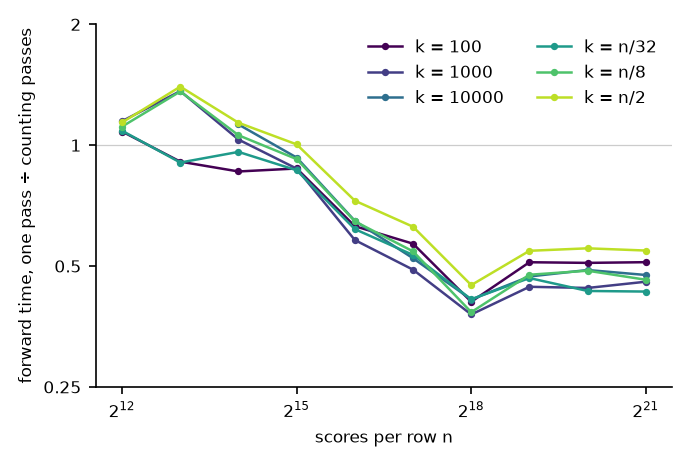

# Finding the k-th largest score

The operator needs c, the k-th largest score of each row. The forward kernel has two ways to
find it.

- **Counting passes**, for short rows. Each pass counts the scores above a trial value and moves
  one end of an interval around c to the nearest score, so the interval closes exactly on c.
- **During the first pass**, for long rows. The kernel already reads each row once for its sum,
  minimum and maximum. Before that pass it takes a sample of the row and picks two sample values
  that bracket c with high probability. During the pass it counts the scores above the upper
  value and copies the few scores between the two values to a small buffer, which then holds c.
  A row whose bracket misses, or whose buffer overflows, continues with counting passes from the
  interval the pass found, so the result is always exact.



The figure shows the forward time of the second way divided by that of the first, on one NVIDIA
RTX 5060 Ti with 32-bit floats, τ = 1 and Gaussian random scores, as medians of 20 calls. A batch
is 4096 rows up to 32,768 scores per row, and 512 MB of scores beyond that. Each way uses the
fastest of the kernel settings tried for it.

- The single pass is faster from 32,768 scores per row for every k, and from 8192 when k is 256
  or less. The library switches at those lengths.
- From 262,144 scores per row it halves the forward time.
- Shorter rows stay in the GPU's cache, where repeated passes are cheap, which is why counting
  passes win there.

The lengths at which the library switches, and its other kernel settings, were chosen from these
measurements on this one GPU model and have not been checked on another.

## Reproducing

```sh
uv run python benchmarks/sweep.py --out benchmarks/results/sweep.json             # time both ways over row length and k
uv run python benchmarks/sweep.py --out benchmarks/results/sweep.json --library   # then the library as configured
uv run python benchmarks/sweep.py --plot benchmarks/results/sweep.json docs       # redraw the figures
```

`benchmarks/select.py` compares these and other selection methods as standalone kernels, and its
`--census` option counts how often a row's bracket misses: 481 of about 1.3 million rows over ten
kinds of input, leaving out the two kinds with very many equal scores.
